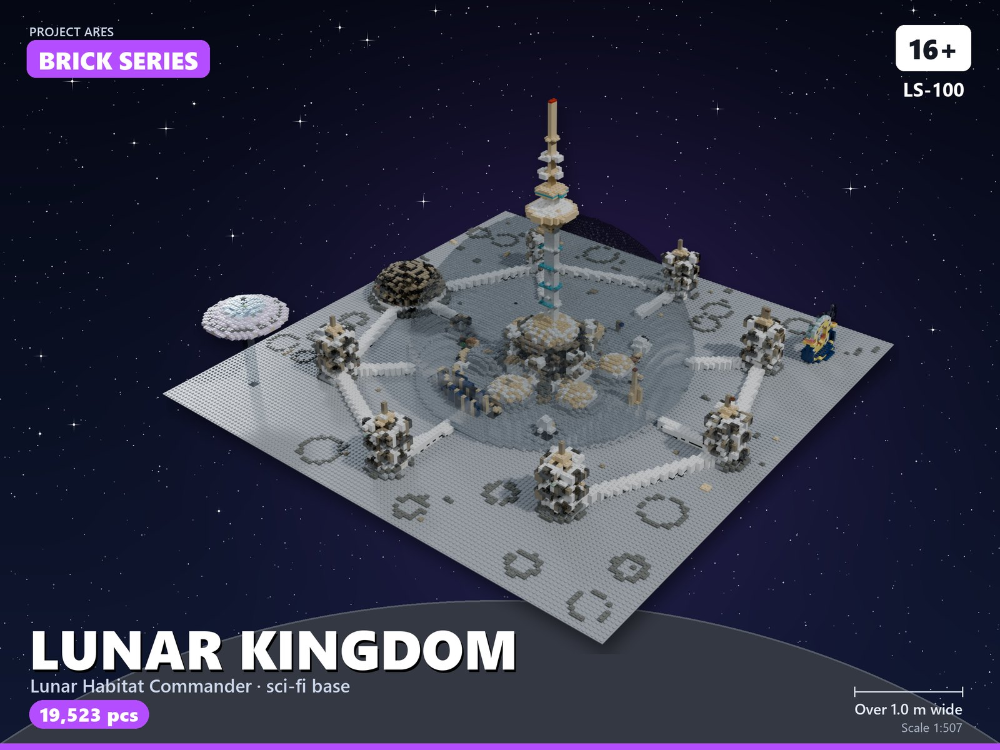

# Lunar Brick Sets · Project ARES

**Website: https://jaigod.github.io/lunar-brick-sets/**

Every habitat and wearable we modelled for our NASA HUNCH project, rebuilt from standard bricks and plates. There are 20 sets and 168,660 pieces in all.



Each set comes with:

- **Box art** (front and back)
- **A parts list** with real part numbers and colour names (CSV)
- **A building guide** (PDF): it builds bottom-up, one module per bag, and shows earlier steps faded so the new pieces stand out
- **A Blender file** with a build animation: open it and press Space

| Set | Name | Series | Pieces | Bags / steps | Files |
|---|---|---|---:|---|---|
| LS-100 | **Lunar Kingdom** | Sci-Fi | 19,523 | 20 / 90 | [PDF](sets/ls-100/instructions.pdf) · [parts](sets/ls-100/parts_list.csv) · [.blend](sets/ls-100/LS-100%20Lunar%20Kingdom.blend) |
| LS-201 | **Dome City** | Concept Habitats | 14,318 | 6 / 63 | [PDF](sets/ls-201/instructions.pdf) · [parts](sets/ls-201/parts_list.csv) · [.blend](sets/ls-201/LS-201%20Dome%20City.blend) |
| LS-202 | **Ring Station** | Concept Habitats | 5,960 | 5 / 52 | [PDF](sets/ls-202/instructions.pdf) · [parts](sets/ls-202/parts_list.csv) · [.blend](sets/ls-202/LS-202%20Ring%20Station.blend) |
| LS-203 | **Capsule Tower** | Concept Habitats | 4,144 | 7 / 65 | [PDF](sets/ls-203/instructions.pdf) · [parts](sets/ls-203/parts_list.csv) · [.blend](sets/ls-203/LS-203%20Capsule%20Tower.blend) |
| LS-204 | **Regolith Hub** | Concept Habitats | 9,035 | 5 / 63 | [PDF](sets/ls-204/instructions.pdf) · [parts](sets/ls-204/parts_list.csv) · [.blend](sets/ls-204/LS-204%20Regolith%20Hub.blend) |
| LS-205 | **Modular Surface Base** | Concept Habitats | 6,177 | 9 / 68 | [PDF](sets/ls-205/instructions.pdf) · [parts](sets/ls-205/parts_list.csv) · [.blend](sets/ls-205/LS-205%20Modular%20Surface%20Base.blend) |
| LS-206 | **Lunar Home** | Concept Habitats | 3,211 | 9 / 55 | [PDF](sets/ls-206/instructions.pdf) · [parts](sets/ls-206/parts_list.csv) · [.blend](sets/ls-206/LS-206%20Lunar%20Home.blend) |
| LS-207 | **Hard-Shelled Habitat** | Concept Habitats | 17,267 | 2 / 67 | [PDF](sets/ls-207/instructions.pdf) · [parts](sets/ls-207/parts_list.csv) · [.blend](sets/ls-207/LS-207%20Hard-Shelled%20Habitat.blend) |
| LS-208 | **Crew Wellness Dome** | Concept Habitats | 17,361 | 7 / 60 | [PDF](sets/ls-208/instructions.pdf) · [parts](sets/ls-208/parts_list.csv) · [.blend](sets/ls-208/LS-208%20Crew%20Wellness%20Dome.blend) |
| LS-209 | **Smart Adaptive Habitat** | Concept Habitats | 8,180 | 8 / 65 | [PDF](sets/ls-209/instructions.pdf) · [parts](sets/ls-209/parts_list.csv) · [.blend](sets/ls-209/LS-209%20Smart%20Adaptive%20Habitat.blend) |
| LS-210 | **Biotech Collection** | Concept Habitats | 4,061 | 8 / 56 | [PDF](sets/ls-210/instructions.pdf) · [parts](sets/ls-210/parts_list.csv) · [.blend](sets/ls-210/LS-210%20Biotech%20Collection.blend) |
| LS-301 | **Moon Base Final** | Moon Base Final | 11,851 | 15 / 59 | [PDF](sets/ls-301/instructions.pdf) · [parts](sets/ls-301/parts_list.csv) · [.blend](sets/ls-301/LS-301%20Moon%20Base%20Final.blend) |
| LS-401 | **Wellness Dock** | LUNA VR | 8,697 | 2 / 44 | [PDF](sets/ls-401/instructions.pdf) · [parts](sets/ls-401/parts_list.csv) · [.blend](sets/ls-401/LS-401%20Wellness%20Dock.blend) |
| LS-402 | **Airlock** | LUNA VR | 12,672 | 2 / 75 | [PDF](sets/ls-402/instructions.pdf) · [parts](sets/ls-402/parts_list.csv) · [.blend](sets/ls-402/LS-402%20Airlock.blend) |
| LS-403 | **AI Command Center** | LUNA VR | 4,456 | 2 / 49 | [PDF](sets/ls-403/instructions.pdf) · [parts](sets/ls-403/parts_list.csv) · [.blend](sets/ls-403/LS-403%20AI%20Command%20Center.blend) |
| LS-404 | **Sleep Pod** | LUNA VR | 10,007 | 2 / 67 | [PDF](sets/ls-404/instructions.pdf) · [parts](sets/ls-404/parts_list.csv) · [.blend](sets/ls-404/LS-404%20Sleep%20Pod.blend) |
| LS-501 | **LUNA-X Smart Suit** | LUNA-X | 5,038 | 9 / 68 | [PDF](sets/ls-501/instructions.pdf) · [parts](sets/ls-501/parts_list.csv) · [.blend](sets/ls-501/LS-501%20LUNA-X%20Smart%20Suit.blend) |
| LS-502 | **LUNA-X Adaptive Helmet** | LUNA-X | 2,072 | 12 / 53 | [PDF](sets/ls-502/instructions.pdf) · [parts](sets/ls-502/parts_list.csv) · [.blend](sets/ls-502/LS-502%20LUNA-X%20Adaptive%20Helmet.blend) |
| LS-503 | **LUNA-X Wellness Glove** | LUNA-X | 1,102 | 2 / 28 | [PDF](sets/ls-503/instructions.pdf) · [parts](sets/ls-503/parts_list.csv) · [.blend](sets/ls-503/LS-503%20LUNA-X%20Wellness%20Glove.blend) |
| LS-504 | **LUNA-X Mobility Boot** | LUNA-X | 3,528 | 2 / 62 | [PDF](sets/ls-504/instructions.pdf) · [parts](sets/ls-504/parts_list.csv) · [.blend](sets/ls-504/LS-504%20LUNA-X%20Mobility%20Boot.blend) |

## How the sets were made

`tools/brickset.py` runs inside Blender in the background. For each set it:

1. Copies the original model to a temp folder and reads only the copy. The original file is never opened or changed.
2. Samples every surface onto a stud grid (8 mm studs, 3.2 mm plates) and picks the nearest standard brick colour, including transparent and metallic ones.
3. Packs each layer into real brick and plate sizes, staggering joints between layers, then adds studs and a baseplate or display stand.
4. Builds the set in a brand-new blank Blender file, renders the box art in Cycles and the instruction steps in Workbench, then lays out the box and the booklet.

Run it yourself:

```
blender --background --factory-startup --python tools/brickset.py -- config.json all
```

Part numbers are the common brick and plate moulds. A few colour and part combinations may not exist in real stock, so swap in a nearby colour if you build one for real.

Part of [Project ARES · Lunar Smart Adaptive Habitat](https://jaigod.github.io/LunarSmartAdaptiveHabitat/), a NASA HUNCH project by Jaineil R., Angel C. and Farhan K.
